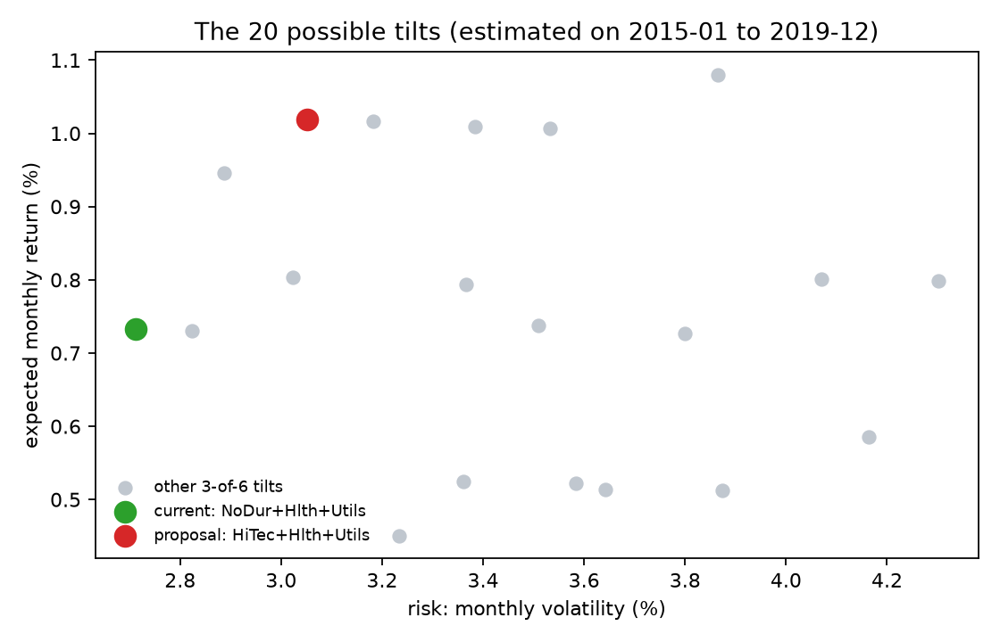
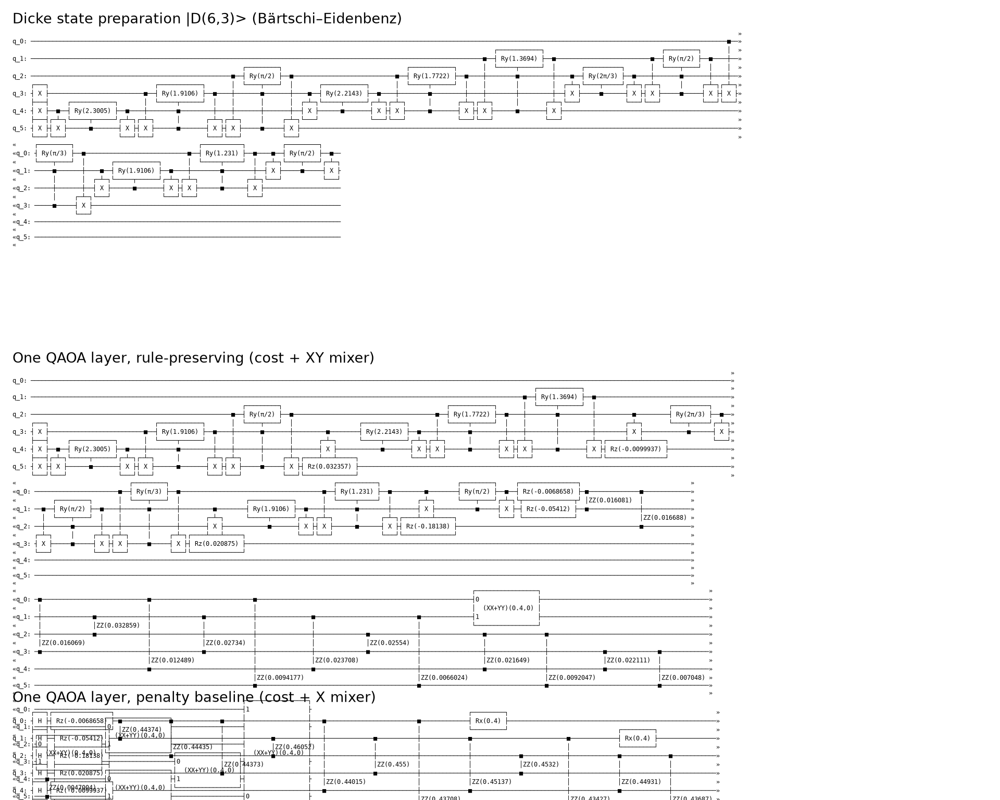
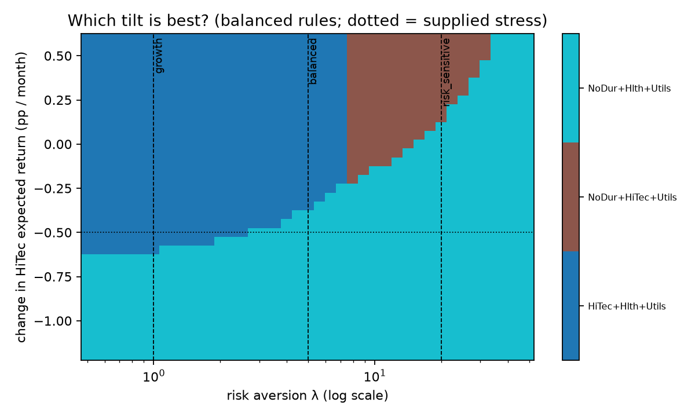
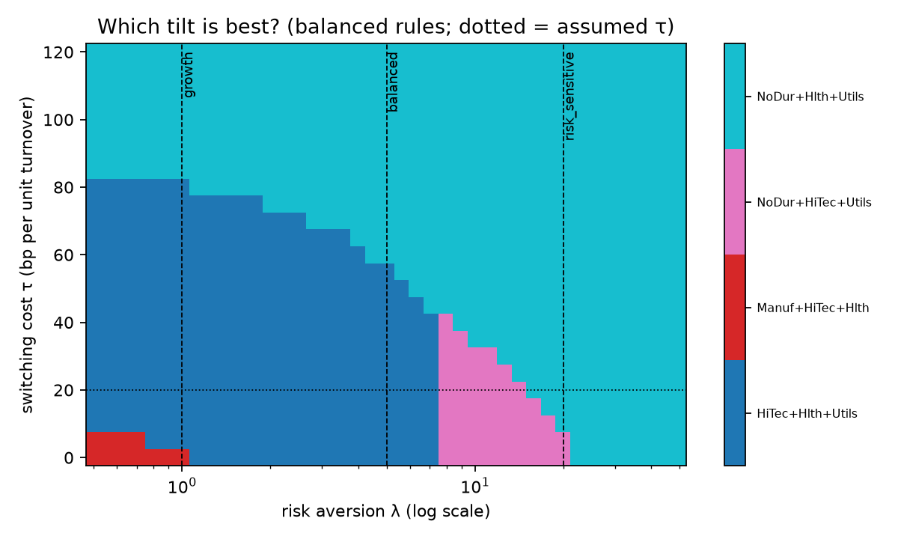
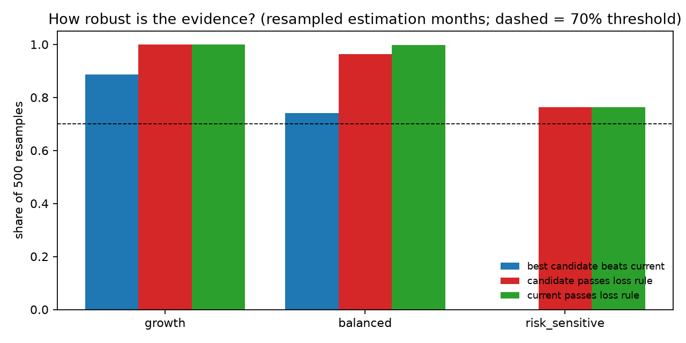
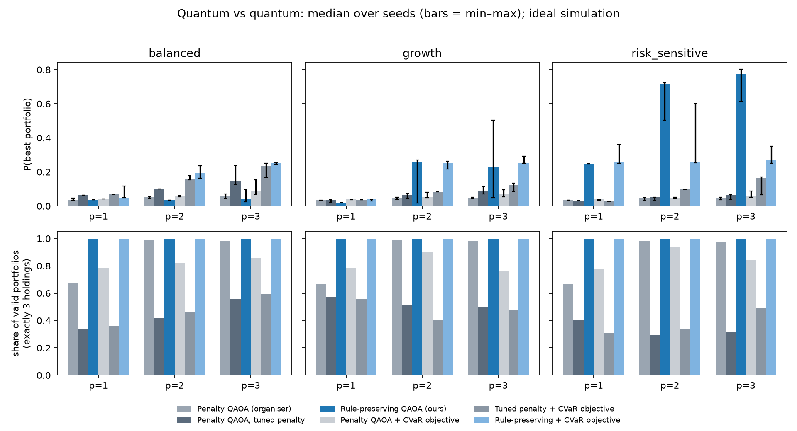
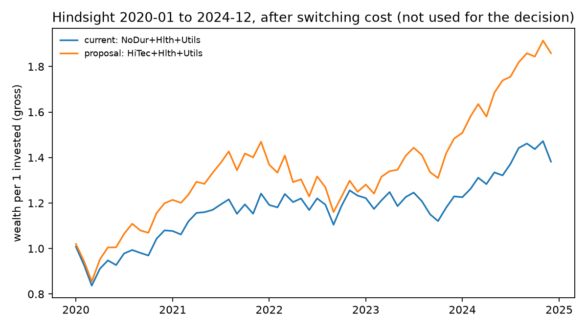

# Plain-language guide

For readers from finance, policy or the jury. No quantum or maths background needed.
All numbers come from the canonical run (`results/canonical/summary.json`, ideal simulation, fixed seeds). Figures: `results/canonical/figures/`.

---

## 1. The problem

**Date:** 31 December 2019. A fund holds a small part of its stock money in three US industries, one third each:
consumer staples (NoDur), healthcare (Hlth) and utilities (Utils). These are calm, defensive industries.

**Proposal:** sell consumer staples, buy technology (HiTec). Tech has had a great five years.

**Task:** decide, for three types of investor, whether to **keep** the holding, **switch**, or call for a **review**.

Why this is not trivial:

1. **More return means more risk.** The proposal earned about 0.29 percentage points more per month in 2015-19
  , but it swings more.
2. **Rules are not wishes.** Some conditions must always hold. Others are things we would like but can trade off.
3. **The numbers are guesses.** Only 60 months of data. A great tech rally in those months may not repeat.
4. **Switching costs something.** A switch is only worth it if the gain clearly beats the cost and the uncertainty.

## 2. The client

The **German government**, which plans a mandatory, funded part of the state pension, the
**gesetzliche Kapitalrente**. An extra 2 % of wages would be invested by a **public fund** (modelled on KENFO),
run by an independent committee of external experts. The expert commission asked for the *broadest possible
diversification*, low costs (at most 0.1 % per year) and no guarantees.

How we fit a 3-of-6 choice into that: the fund's main holding is a broad index (**core**). We only decide a small
**tilt (satellite)** on top: three of six sectors, equal weight. The tilt is a small bet, not the whole portfolio.

**Who is who**

| Role | Who |
|---|---|
| Decides | The fund's investment committee |
| Uses the result | Portfolio managers |
| Bears the losses | The insured people |
| Approves the framework | Parliament / the labour ministry (supervisor still open) |

**Three profiles, chosen actively.** Each insured person chooses *growth*, *balanced* or *risk-sensitive*.
It is **not** decided by age, because age-based tilts would treat generations unequally. People who do not choose
get a default, and we assume that is *balanced*. This is an open assumption, and it matters: the balanced profile is
the one whose answer is most fragile (see section 6).

All numbers that define the profiles (how much risk bothers them, how large a loss is tolerated) are **assumptions
from the organiser's task**, not facts from the commission.

## 3. The rules

We separate two kinds of conditions on purpose.

**Binding rules.** These are never traded against return. A portfolio that breaks one is simply not allowed.

| Rule | Meaning |
|---|---|
| Exactly 3 holdings | Equal weights, no shorting, no borrowing |
| Loss tolerance | The chance of losing more than 8 % (growth), 5 % (balanced) or 3 % (risk-sensitive) in a month must be at most 10 %. Checked exactly after the choice |

**Preferences.** These are traded against each other in one score (lower is better):

* higher expected return (good)
* lower risk (good, weighted more for cautious profiles: weights 1 / 5 / 20)
* fewer changes to the current holding (a small switching cost, 0.002 per full turnover)
* staying under a technology weight limit of 100 % / 35 % / 20 %. **This is a preference**, not a binding rule
  (team decision 16 Oct): breaking it costs score, it does not forbid. It is a limit that the committee may weigh, not a law.

Why the split matters: if everything sat in one score, enough extra return could "buy" a rule violation.
Keeping binding rules outside the score prevents that.

## 4. The 20 options

Choosing 3 industries out of 6 gives exactly **20** possible portfolios. We compute all 20 with a normal program.
This is the **answer key**. It also means the problem is far too small to need a quantum computer. Be clear about that.

Each option gets a score and passes or fails the loss check. The best passing one is the answer for that profile. The loss check removes few options for growth (0 of 20) and balanced (1 of 20), but many for risk-sensitive: only **7 of 20** pass.

## 5. The quantum idea, in simple words

**What we encode.** Six switches, one per industry: on = held, off = not held. A setting of the six switches is one portfolio.
There are 64 settings, but only 20 have exactly three switches on. Those are the legal ones.

**What QAOA does.** Think of a ball rolling over a landscape of 64 (or 20) valleys, where the depth of a valley is the
portfolio's cost. QAOA makes a quantum "cloud" that sits on all options at once. Then it repeats two steps, *p* times:

1. **Cost step:** the cloud is tilted so that cheap portfolios become more likely.
2. **Mixing step:** the cloud is stirred so it can move to neighbouring portfolios.

A classical computer adjusts two knobs per round (how hard to tilt, how hard to stir), and tries again.
At the end we "look" at the cloud many times; the most frequent answer is the suggestion.

**Two ways to do it (quantum against quantum)**

| | Organiser's version (penalty QAOA) | Our version (Dicke + XY QAOA) |
|---|---|---|
| Start | Cloud over all 64 settings | Cloud over only the 20 legal ones (a *Dicke state*) |
| Stirring | Flips single switches: can leave the legal set | *XY mixer*: swaps an "on" and an "off" switch: always stays at exactly 3 on |
| The "3 holdings" rule | A big punishment added to the cost; the cloud still spends time on illegal portfolios | Cannot be broken by construction |
| Analogy | Fence around a field, and the sheep still wander into the road | A field where the road simply does not exist |

We also tried a second way of scoring the cloud (a *CVaR objective*: focus on the best fraction of samples) and a *tuned* penalty for the organiser version, so the comparison is fair: six variants in total.

The loss tolerance cannot be built into the circuit cheaply (it counts scenarios), so it is checked exactly on the
result. If the top answer fails the check, we take the best answer that passes.

## 6. What changes the answer (robustness)

We never rely on one run. We change one thing at a time and see whether the answer flips.

| Kind of change | Examples |
|---|---|
| Financial assumptions | Supplied return stress (HiTec -0.5 points per month), supplied correlation stress (+25 % towards 1), bootstrap resampling of the 60 months |
| Profile / mandate choices | Risk weight, switching cost, loss limit, tech limit |
| Computation | Which mixer, how many layers *p*, random seeds, number of shots |

**How a verdict is reached.** The burden of proof is on the change.

* **Switch** needs: the same best portfolio in all three scenario sets (base, return stress, covariance stress), *and* it beats the current holding in at least 70 % of 500 bootstrap resamples, *and* it passes the loss rule in at least 70 % of them.
* **Keep** needs: the current holding is best everywhere and passes the loss rule in at least 70 % of resamples.
* Otherwise: **Review**. The default action is to hold, and the committee decides with a stated belief.

Results:

| Profile | Verdict | Evidence |
|---|---|---|
| Growth | **Switch** to HiTec + Hlth + Utils | Same winner in all 3 scenario sets; beats current in 89 % of resamples |
| Balanced (assumed default) | **Review** | Winner flips to the current holding under the return stress; proposal beats current in 74 % of resamples |
| Risk-sensitive | **Keep** NoDur + Hlth + Utils | Winner in all 3 sets; passes the loss rule in 76 % of resamples (in 12.6 % no portfolio passes) |

For balanced, the tipping points are close to today's values:

* HiTec's monthly edge **0.37 points lower** flips it to the current holding (the supplied stress is 0.5).
* Switching cost of **0.0057** (about 3 times the base 0.002) flips it.
* Risk weight: the proposal gives way to NoDur + HiTec + Utils at **7.5**, and to the current holding at **14.9** (balanced uses 5).

The tech limit is a preference (penalty 0.01); the verdicts are identical with the penalty set to zero. The risk-sensitive proposal passes the loss rule only at exactly 6 of 60 months (10 %) and **fails under a strict "less than" reading**, so the wording of the rule matters.

An unchanged conclusion is also informative, as long as we say how we tested it.

## 7. How we check ourselves

* **Answer key:** every quantum result is compared with the exact enumeration of all 20.
* **Feasibility:** every returned bitstring is checked (3 holdings, loss rule). We never trust the solver blindly.
* **Many seeds:** QAOA is random. We report median and spread over many starts, not one lucky run.
* **Tests:** `python -m pytest -q` includes comparisons with brute force.
* **Two kinds of uncertainty, kept apart:** (1) *estimation uncertainty* from the data, measured by resampling the 60 months;
  (2) *computational variation* from seeds and shots. A different answer between seeds is a different thing from
  a different answer between data samples.
* **Quantum against quantum** (ideal simulation, 10 seeds, 3 layers; median chance of sampling the exact best portfolio; guessing = 0.05):

| Profile | Ours (Dicke + XY) | Organiser penalty QAOA | Tuned penalty |
|---|---|---|---|
| Risk-sensitive | **0.77** | 0.05 | 0.07 |
| Growth | 0.23 (CVaR variant 0.25) | 0.05 | 0.09 |
| Balanced (near-tie) | 0.04 with the mean objective; 0.25 with CVaR | 0.06–0.15 | 0.15 |

Ours returns **100 % valid portfolios**; the penalty versions 32–98 %. Results vary a lot between seeds (see the min-max bars in the figure), and optimising the mean cost does not maximise the chance of the best portfolio. For balanced, our CVaR variant decodes the right answer in 90 % of runs. In honesty: at the near-tie the tuned penalty also does well on probability, but with only about half of its samples valid. The exact enumeration is the answer key and no quantum advantage is claimed.

* **Hindsight (2020-24):** used only after the fact, never for the decision. Including the one-off switching cost, the proposal grew to 1.86 against 1.38 for the current holding, with a deeper drawdown (−21 % vs −17 %). The share of months with a loss above each profile's own threshold was 5 % vs 3 % (growth, 8 %), 13 % vs 8 % (balanced, 5 %) and 20 % for both (risk-sensitive, 3 %), higher than the 2015-19 estimates. Rebalancing at 2 % or 5 % drift did not beat simply holding for the proposal. One path proves nothing about whether the 2019 decision was right.

## 8. Limits

* No quantum advantage. 20 options are trivial for a normal computer.
* Simulation only, on a laptop. No noise, no hardware.
* 60 data points; US industries instead of a global fund; no liquidity, tax or ESG data.
* Equal weights and 3 holdings are simplifications. The switching cost is a proxy.
* The profile numbers are assumptions.

## 9. Glossary

| Term | Meaning |
|---|---|
| Allocation | Deciding how to split money across assets |
| Satellite / core | Small tilt on top of a large broad holding |
| Mandate / profile | The rules and preferences of one type of investor |
| Binding rule | A condition that must hold; never traded against return |
| Preference | A wish that is weighed in the score |
| Risk weight (λ) | How much a cautious investor dislikes risk; higher means more cautious |
| Turnover | Share of the portfolio that is replaced |
| QUBO | A way to write a yes/no decision problem as one formula that a quantum algorithm can use |
| QAOA | Quantum algorithm that alternates a cost step and a mixing step, tuned by a classical optimiser |
| Dicke state | Quantum starting state that spreads evenly over all choices with exactly k "yes" |
| XY mixer | Mixing step that swaps a "yes" and a "no", so the number of "yes" never changes |
| Penalty | Extra cost added to discourage rule breaking (can fail if too small, or squash the signal if too big) |
| Answer key | Exact result from checking all options; used to grade the quantum runs |
| Bootstrap | Resampling the 60 months many times to see how much the answer depends on the exact data |
| Seed | Starting number of a random process; fixing it makes results repeatable |
| Shots | How many times the quantum circuit is measured |
| Break-even | The value of an assumption at which the best choice flips |
| Hold-out | Data kept back (2020-24) for judging afterwards only |
| Quantum advantage | Being provably better than any classical method. We do **not** claim it |
| KENFO | German public fund for nuclear waste; the named template for the Kapitalrente fund |
| DORA | EU rules for digital operational resilience, including outside IT / compute providers |
