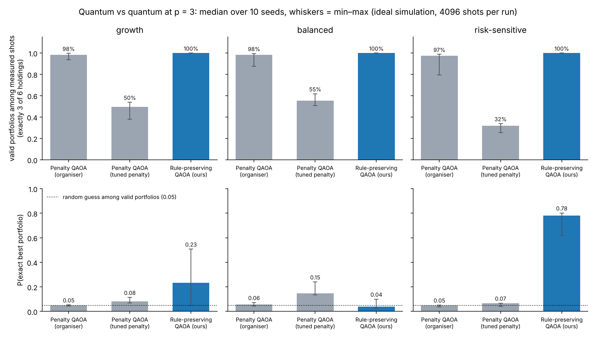
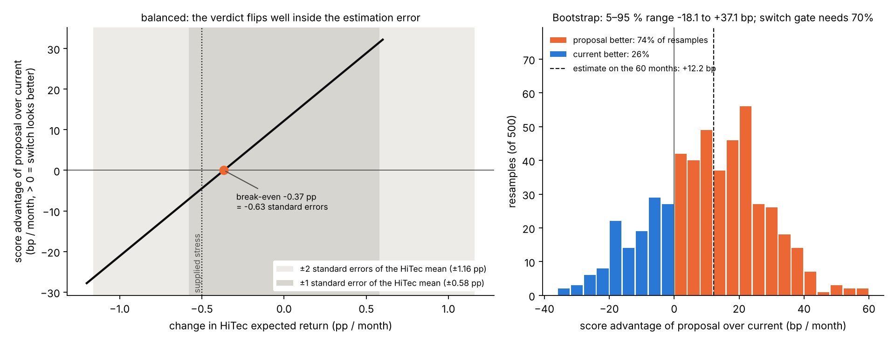
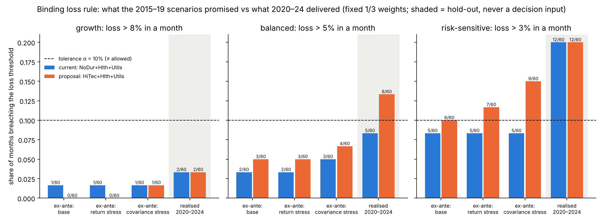
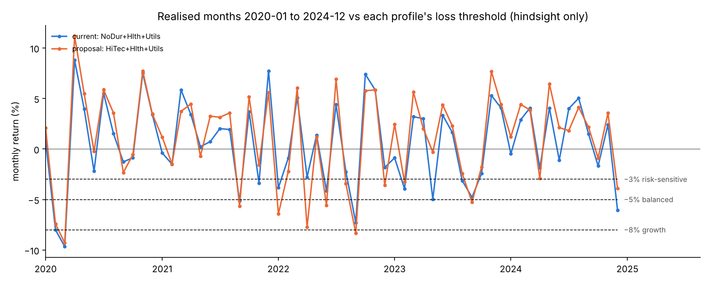

# Keep, review or switch? Briefing for the sync with Eden

Thursday 29 October 2026 · final pitch Friday 30 October · slide deck: `docs/deck/Quantum_Hackathon_28_10_updated.pptx`

Everything here uses **real data** only (the organisers' file, Jan 2015 to Dec 2024) and one command that anyone can
re-run: `python scripts/run_all.py run --canonical` (about 22 minutes on a laptop, fixed random seeds). We needed no
synthetic data. All numbers: `results/canonical/summary.json`.

## 1. The whole project in plain words

**The situation.** Germany plans a public pension fund. Most of its money sits in a broad index. A small part, the
"tilt", holds three of six US industry sectors in equal thirds: consumer staples, healthcare and utilities. It is the end
of 2019. Someone proposes to swap consumer staples for technology, because tech did very well in 2015 to 2019.

**The people.** Three savers stand for the three profiles a saver can choose:

* **Lena** chose *growth*. She accepts big swings.
* **Thomas** made no choice, so he was placed in *balanced* (the default).
* **Anna** chose *risk-sensitive*. She dislikes swings.

**The rules.** Each profile has a hard loss limit. A "loss month" is a month that loses more than 8 % (Lena), 5 % (Thomas)
or 3 % (Anna). At most 6 of 60 months may be loss months. No amount of extra return can buy a breach.

**How we decide.** A normal computer scores all 20 possible baskets: more return is good, more swings are bad, and
switching costs a little. This exact scoring is our answer key. We only switch if the evidence is strong: the same basket
must win in every test setting, and it must win in at least 70 % of 500 "replays" of history (the 60 months reshuffled).
Otherwise the answer is **review**: keep what you have until the committee decides.

**The answer.**

| Saver | Answer | Why, in one line |
|---|---|---|
| Lena (growth) | **Switch** to tech + healthcare + utilities | Tech wins in every test and in 89 % of replays |
| Thomas (balanced, default) | **Review**, hold for now | A small stress test flips his answer; the data cannot tell the two baskets apart |
| Anna (risk-sensitive) | **Keep** consumer staples + healthcare + utilities | Her basket wins in every test; the tech basket sits right on her loss limit |

**Where quantum comes in.** We built a quantum circuit that can only ever propose a legal basket (exactly three sectors).
We compare it with the organisers' circuit, and grade both against the exact answer key. There is **no quantum
advantage**: a laptop checks all 20 baskets in milliseconds. The value is a circuit that cannot break the rules, and an
honest test of it.

## 2. The three new pictures (slides 10, 12 and 14)

### Picture 1 (slide 12): does the quantum circuit work?

**In plain words.** We ask each circuit 4,096 times for a basket. The **top row** shows how often the answer is a legal
basket. Ours: every single time. The **bottom row** shows how often it names the *best* basket. For Anna, ours names it
78 times out of 100; the organisers' circuit 5 times out of 100, which is what blind guessing among 20 baskets gives.
For Thomas, two baskets are almost equally good, and ours is no better than guessing.

| Saver | Legal answers: ours / organisers' / organisers' tuned | Best basket found: ours / organisers' / tuned |
|---|---|---|
| Lena | 100 % / 98 % / 50 % | 0.23 / 0.05 / 0.08 |
| Thomas | 100 % / 98 % / 55 % | 0.04 / 0.06 / 0.15 |
| Anna | 100 % / 97 % / 32 % | **0.78** / 0.05 / 0.07 |

* Why the organisers' circuit struggles: it only *punishes* illegal baskets. Punish hard, and almost every answer is legal
  but the circuit stops looking for a good one. Punish gently, and half the answers are illegal. Ours has no such
  trade-off, because illegal baskets cannot appear at all.
* Honest limits: ideal simulation, 3 layers, median of 10 runs (Lena's runs range from 0.05 to 0.51). With simulated
  measurement noise during tuning, ours drops to 0.36 for Anna and 0.02 for Lena. For Thomas, a variant with a different
  goal (CVaR) reaches 0.25.

### Picture 2 (slide 10): why Thomas gets "review"

**In plain words.** Our numbers come from only 60 months. Tech's average return of 1.51 % a month could easily be
0.58 points higher or lower (the dark grey band). Thomas's answer flips if tech earns just **0.37 points** less: that is
smaller than the wobble in the estimate. On the right, we replayed history 500 times: the switch was better in 74 % of
replays and worse in 26 %. That is like a coin that is only slightly bent. It is not enough to move people's pension money.

* The tech basket's lead for Thomas: 12 basis points a month; across the replays it ranges from −18 to +37 (5 to 95 %).
* The organisers' own stress test lowers tech by 0.5 points, already beyond Thomas's flip point.
* Lena's flip point is 0.60 points (about one full wobble away), so her answer is stable. Anna would need tech to do
  *better*, not worse.

### Picture 3 (slide 14): did the loss limit hold in 2020 to 2024?

**In plain words.** We checked the loss rule against what really happened later. These years were never used to decide.
**Lena:** fine, 2 loss months for both baskets. **Thomas:** his current basket stayed within the limit (5), the tech basket
would have broken it (8), so waiting was the safer call. **Anna:** every 2015 to 2019 test promised 5 loss months; reality
brought **12**, twice the limit, for both baskets. Lesson: a loss model built on 60 calm months was too optimistic.

| Saver (loss threshold) | Basket | 2015-19 data | Tech stress | Sectors-move-together stress | Real 2020-24 |
|---|---|---|---|---|---|
| Lena (8 %) | current | 1 | 1 | 1 | 2 (ok) |
| Lena (8 %) | tech | 0 | 0 | 1 | 2 (ok) |
| Thomas (5 %) | current | 2 | 2 | 3 | 5 (ok) |
| Thomas (5 %) | tech | 3 | 3 | 4 | **8 (broken)** |
| Anna (3 %) | current | 5 | 5 | 5 | **12 (broken)** |
| Anna (3 %) | tech | 6 | 7 (broken) | 9 (broken) | **12 (broken)** |

Loss months out of 60; at most 6 allowed. Fixed one-third weights, as the rule defines it.

In money terms: one unit invested in the tech basket grew to 1.86, in the current basket to 1.38 (after the switching cost). The
tech basket also fell deeper (−21 % against −17 %). One lucky path does not prove the 2019 decision right or wrong.

## 3. When an assumption changes

One changed assumption re-runs in about a minute (`--fast --set ...`), and `diff` says what flipped and why.

| Change | What happens |
|---|---|
| Switching costs three times as much (`change_penalty=0.006`) | Thomas: review becomes keep. Lena: switch becomes review |
| Thomas's loss threshold 4 % instead of 5 % (`balanced.loss_threshold=0.04`) | No answer changes; 15 instead of 19 baskets stay within his limit |

## 4. Synthetic data: not needed

All pictures run on real data in one reproducible command, so the deck is **100 % real data, 0 % synthetic**. Synthetic
numbers on a decision slide would hurt exactly what we are graded on (traceability, reproducible code, honest limits).
The only acceptable use would be a clearly labelled "synthetic scaling example" (10 to 20 random assets) to show how the
circuit grows, never feeding an answer. Replays of history are not synthetic data: they reuse the real 60 months.
Re-run on a second laptop: same answers; exact numbers identical, quantum numbers within 0.01.

## 5. Eden's earlier questions: where the deck answers them

The speaker notes of the 28 October deck mark these answers. Questions 2 and 3 are not marked in the deck; please check
that they are covered.

| Eden's question | Answered on |
|---|---|
| 1 · a concrete problem and a concrete user | slide 2 (Lena, Thomas and Anna) |
| 4 and 6 · what we showed, what is assumed or untested, what comes next | slide 15 ("Next steps" column now filled) |
| 5 · the technical part through a concrete example | slide 11 (the circuit), with its test on slide 12 |
| 2 and 3 | not marked in the speaker notes |

## 6. Questions for Eden, with our proposed answer

| Question | Our proposal |
|---|---|
| Lead with the decision or with the quantum comparison? | Decision first (slides 2 to 10), quantum second (11 to 12). The jury grades the fit of problem, method and evidence |
| Is "review" convincing as the headline for Thomas? | Yes, with the reason in one line: his flip point (0.37) is smaller than the wobble in the data (0.58) |
| How strong may the quantum claim be? | "Always legal by construction; far better for Anna; no better on a near-tie; no advantage." Mention the drop with noise |
| Where does the broken loss limit in 2020-24 go? | Into the recommendation as a model-risk finding (slide 14 and the decision card), not only into the limits |
| Any slide where synthetic data would help? | No |
| How do we show the Policy Practice Team's feedback was used? | Slide 17 has three policy recommendations. Our decision log records two model changes (profiles chosen by savers, tech limit as a preference) as *team* decisions. If they came from the advisers, say so on a slide and in `docs/decisions.md` |
| How do we split the 20 minutes? | By part of the work: problem and savers, rules and scoring, quantum circuit, robustness and hindsight, policy. Whoever presents a part answers questions on it |

## 7. What changed in the deck (28 Oct version → updated)

* **New slide 10** "Thomas's flip point is inside the noise" (picture 2).
* **New slide 12** "Always a legal basket; far better only for Anna" (picture 1).
* **New slide 14** "The loss limit held for Lena, not for Anna" (picture 3).
* Slide 11: numbers from the latest run (organisers' 97 to 98 % legal, tuned 32 to 55 %, Anna 0.78).
* Slide 15: the empty third column is now "Next steps", filled from the team's own speaker notes; "same numbers on a
  second laptop" became "same verdicts on a second laptop", which is exactly true.
* Page numbers now run 2 to 18 without gaps. Each new slide has speaker notes in plain words.

## 8. Limits to say out loud

60 months of US industry data; equal weights and exactly three sectors; the switching cost is a stand-in, not a fee
model; the profile numbers are assumptions from the organisers; ideal simulation on a laptop. Twenty baskets are solved
exactly in milliseconds, so we claim no quantum advantage.

## 9. Short answers to Eden's questions

The wording of the questions below is taken from the speaker notes of the 28 October deck. Questions 2 and 3 are not
written down in any of our files; send us their wording and we add the answers.

**1. A concrete problem and a concrete user?**
Germany's planned public pension fund must decide, at the end of 2019, whether to keep its small sector slice (consumer
staples, healthcare, utilities) or swap staples for technology. The user is the fund's investment committee; the people
affected are savers like Lena (growth), Thomas (balanced, the default) and Anna (risk-sensitive). Slide 2.

**2 and 3.** Wording not in our files; to be added.

**4. What did we show, and what is assumed or untested?**
Shown: a clear answer per saver (Lena switch, Anna keep, Thomas review); a quantum circuit that never proposes an illegal
basket, checked against the exact answer; a map of what would flip each answer; the same verdicts on a second laptop with
one command. Assumed: the profile numbers (from the organisers), equal weights, exactly 3 of 6 sectors, switching cost as
a stand-in, 60 months of US data. Untested: noise and real hardware, larger problems, real savers. Slide 15.

**5. The technical part through a concrete example?**
Anna: the circuit starts on the 20 legal baskets only, pushes towards better scores and mixes while always keeping three
sectors. After 4,096 looks it names her best basket 78 times out of 100; the organisers' penalty circuit 5 times out of
100, which is blind guessing. The exact answer key confirms it is the right basket. Slides 11 and 12.

**6. What limits it, and what comes next?**
Limits: the data cannot settle Thomas's case (his flip point 0.37 is smaller than the wobble 0.58); the loss model was too
optimistic (Anna had 12 loss months in 2020-24 where 5 were expected); no quantum advantage at 20 baskets; ideal
simulation only. Next: noisy simulation then hardware, strong classical solvers on larger problems, global data in euros,
a tail-risk model beyond 60 calm months, and testing the profile choice with real savers. Slides 14 and 15.
